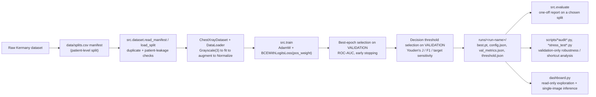
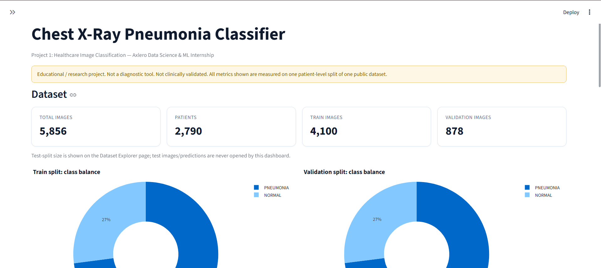
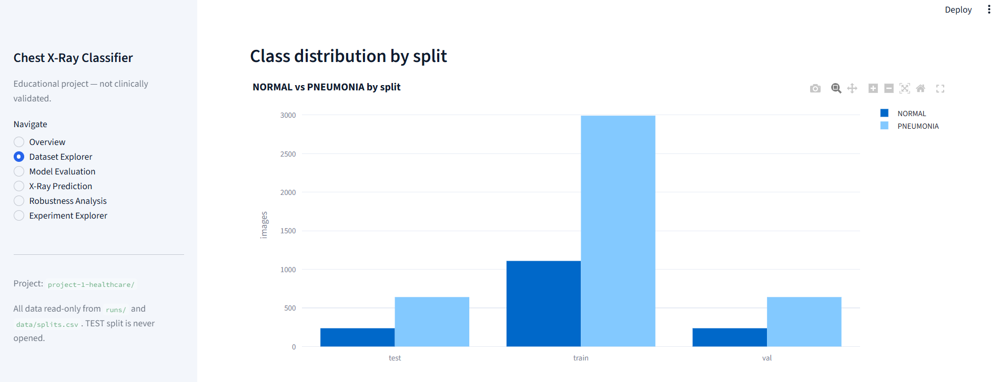
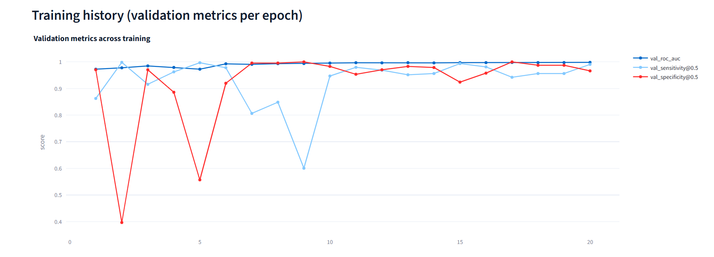
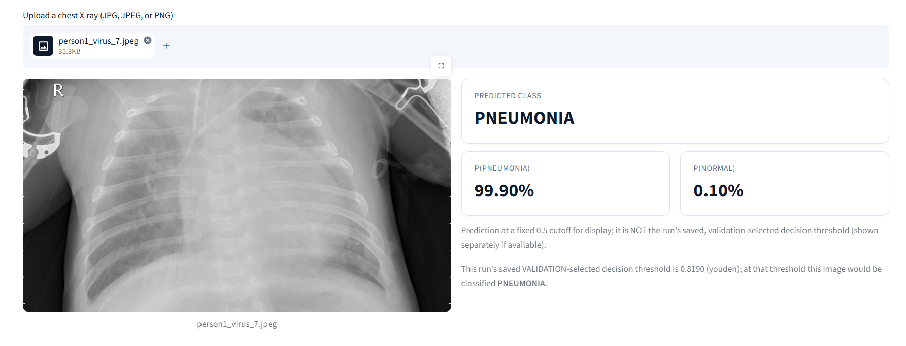
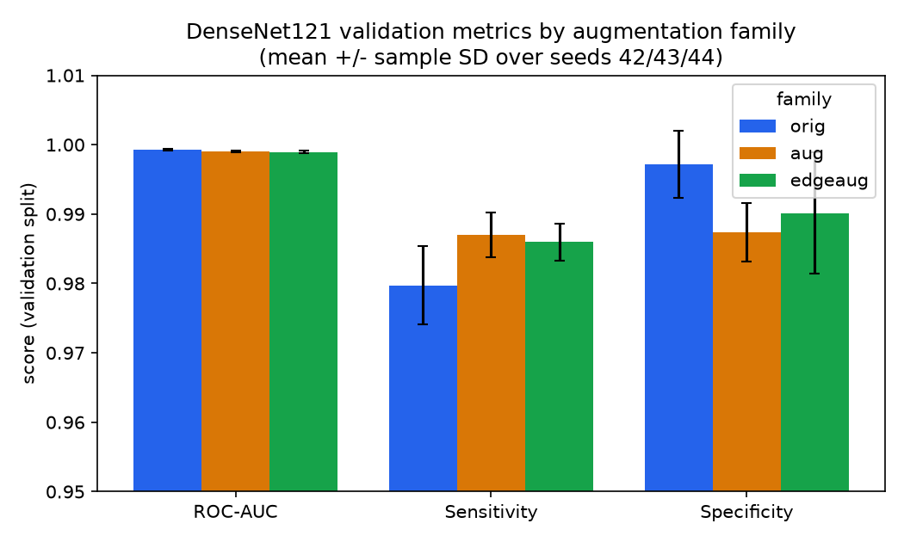
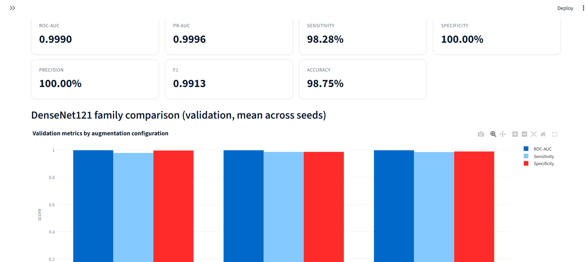
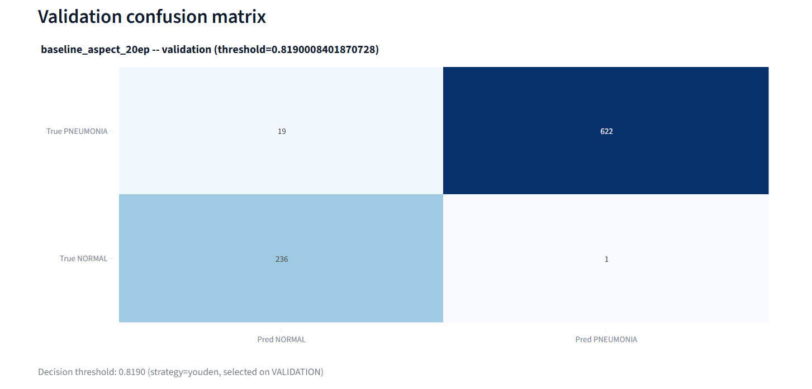
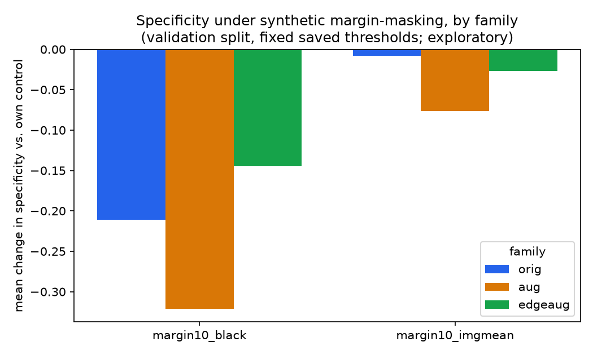

# Healthcare Image Classification: Chest X-Ray Pneumonia Detection

A reproducible PyTorch training, evaluation, and robustness-analysis pipeline for
binary NORMAL vs. PNEUMONIA classification of pediatric chest X-rays, built for the
Axlero Data Science and Machine Learning Internship (Project 1).

**Educational / research project. This is NOT a medical device and NOT a clinically
validated diagnostic tool. Every metric in this document is measured on one
patient-level split of one public dataset and must not be read as evidence of
real-world or clinical performance. Do not use this software to make, or to help make,
any real diagnostic or treatment decision.**

**Key technologies:** Python 3.13, PyTorch / torchvision (DenseNet121 and a small
from-scratch CNN baseline), scikit-learn (metrics, thresholding), pandas / NumPy
(manifest and metadata handling), Matplotlib (static figures), Streamlit + Plotly
(interactive results dashboard).

| Capability | Status |
|---|---|
| Patient-level, leakage-checked train/val/test split | Implemented (`data/splits.csv`, `src/dataset.py`) |
| Two preprocessing modes (squash-resize, aspect-preserving pad) | Implemented (`--preprocess`) |
| Training-only randomised padding augmentation | Implemented (`--pad-aug random`) |
| Training-only randomised edge crop/mask augmentation (EdgeAug) | Implemented (`--edge-aug random`) |
| Validation-only best-epoch and decision-threshold selection | Implemented (`src/train.py`) |
| One-off, frozen test-split evaluation | Implemented (`src/evaluate.py`), used exactly once per reported checkpoint |
| Grad-CAM qualitative visualisation (baseline CNN and DenseNet121) | Implemented (`scripts/gradcam.py`, `scripts/gradcam_densenet.py`) |
| Metadata-only "shortcut" audit | Implemented (`scripts/shortcut_audit.py`) |
| Synthetic perturbation / margin-sensitivity robustness audits | Implemented (`scripts/perturbation_audit_densenet.py`, `scripts/margin_sensitivity_audit.py`) |
| Size-matched stress test | Implemented (`scripts/size_matched_stress_test*.py`) |
| Interactive Streamlit dashboard (6 pages, read-only + single-image inference) | Implemented (`dashboard.py`) |
| Cross-dataset / external validation | **Not implemented** (future work) |

---

## Table of Contents

- [A. Project Header](#healthcare-image-classification-chest-x-ray-pneumonia-detection)
- [B. Overview](#b-overview)
- [C. Features](#c-features)
- [D. Dataset](#d-dataset)
- [E. System Architecture](#e-system-architecture)
- [F. Repository Structure](#f-repository-structure)
- [G. Installation and Setup](#g-installation-and-setup)
- [H. Running the Dashboard](#h-running-the-dashboard)
- [I. Training and Evaluation Commands](#i-training-and-evaluation-commands)
- [J. Experimental Results](#j-experimental-results)
- [K. Graphs and Visualizations](#k-graphs-and-visualizations)
- [L. Edge Augmentation and Robustness Analysis](#l-edge-augmentation-and-robustness-analysis)
- [M. Explainability and Shortcut Learning](#m-explainability-and-shortcut-learning)
- [N. Testing and Quality Assurance](#n-testing-and-quality-assurance)
- [O. Limitations and Ethical Considerations](#o-limitations-and-ethical-considerations)
- [P. Reproducibility](#p-reproducibility)
- [Q. Future Improvements](#q-future-improvements)
- [R. Acknowledgments and References](#r-acknowledgments-and-references)

---

## B. Overview

**Problem.** Pneumonia is diagnosed in part from chest X-rays, and manual reading is
time-consuming and subject to inter-observer variation. This project studies whether a
convolutional network can separate pediatric chest X-rays labeled `NORMAL` from those
labeled `PNEUMONIA`, using a single public, retrospectively-collected dataset.

**Why this is a useful ML research task**, independent of any clinical claim: it is a
binary image-classification problem with real class imbalance, a public, well-studied
dataset, and (as this project's own audits show) real risks of shortcut learning from
acquisition artifacts — all of which make it a good vehicle for practicing a disciplined
train/validation/test methodology, augmentation design, and robustness analysis.

**Labels.** `NORMAL` (0) vs. `PNEUMONIA` (1). Pneumonia images are further sub-typed as
bacterial or viral in the manifest (`subtype` column) but the trained models only predict
the binary label.

**Goals of this project:**
- Build a correct, leakage-free training/evaluation pipeline (patient-level splits,
  validation-only model/threshold selection, a test split touched exactly once).
- Compare a from-scratch CNN baseline against DenseNet121 trained from scratch.
- Investigate whether training-only augmentation (randomised padding, then an
  independent randomised edge crop/mask) changes robustness to synthetic edge/padding
  perturbations, without hurting standard validation performance.
- Audit the dataset and the trained models for shortcut-learning risk.
- Make all of the above explorable through a read-only dashboard.

**What this project does NOT claim:**
- It does not claim diagnostic accuracy, clinical validity, or generalization beyond
  this one dataset's patient-level split.
- It does not claim that synthetic perturbation robustness implies real-world robustness
  to actual acquisition variation.
- It does not claim the dataset-level shortcut-learning risk documented below has been
  resolved — only that it has been measured and partially stress-tested.

---

## C. Features

**Implemented and exercised by the test suite / audits below:**
- Manifest-driven, patient-level 70/15/15 train/val/test split with duplicate-path and
  patient-leakage checks (`src/dataset.py:read_manifest`).
- Two preprocessing modes: `resize` (squash to 224x224) and `pad` (aspect-preserving
  resize + centred constant padding) (`src/dataset.py:build_transforms`,
  `LetterboxSquare`).
- `RandomPadLetterbox`: training-only randomised letterbox fill colour and offset
  (`--pad-aug random`), default off, bit-identical to the unmodified pipeline when off.
- `RandomEdgeMask` ("EdgeAug"): training-only, independent randomised outer-border crop
  or mask (`--edge-aug random`), default off, composable with `--pad-aug` (see
  [section L](#l-edge-augmentation-and-robustness-analysis)).
- Two model architectures: `baseline` (small from-scratch CNN) and `densenet121`
  (torchvision DenseNet121, trained from scratch in all reported runs).
- Validation-only best-epoch selection (by ROC-AUC, PR-AUC, F1, or loss), early
  stopping, and validation-only decision-threshold selection (Youden's J, F1-optimal, or
  a target-sensitivity strategy) (`src/train.py`, `src/metrics.py`).
- One-off frozen test-split evaluation with confusion matrix and full metric report
  (`src/evaluate.py`) — used once per reported checkpoint, never for tuning.
- Grad-CAM for both the baseline CNN and DenseNet121, explicitly labeled as qualitative,
  not proof of correct reasoning (`scripts/gradcam.py`, `scripts/gradcam_densenet.py`).
- A metadata-only "shortcut audit": can image size/aspect/colour-mode alone predict the
  label? (`scripts/shortcut_audit.py`).
- Synthetic perturbation audits (margin masking, letterbox-fill changes, interior "ring"
  masking, centre cropping) against each checkpoint's own fixed, saved validation
  threshold (`scripts/perturbation_audit_densenet.py`, `scripts/margin_sensitivity_audit.py`).
- A size-matched stress test comparing ROC-AUC within caliper-matched, size-balanced
  image pairs (`scripts/size_matched_stress_test*.py`).
- A 6-page Streamlit dashboard (`dashboard.py`) for browsing all of the above and running
  single-image inference, described in full in [section H](#h-running-the-dashboard).

**Experimental / exploratory, not production features:**
- All `scripts/*.py` are one-off analysis scripts run manually from the command line,
  not part of the training pipeline and not scheduled or automated.
- The dashboard's X-Ray Prediction page is explicitly a demo, not a diagnostic tool (see
  its own in-app disclaimer).
- Robustness audit conditions (margin masks, ring masks, trims) are hand-designed and do
  not represent any confirmed real acquisition artifact.

---

## D. Dataset

**Source:** Kermany et al., *Cell* 2018 chest X-ray pneumonia dataset ([data.mendeley.com/datasets/rscbjbr9sj/2](https://data.mendeley.com/datasets/rscbjbr9sj/2),
also mirrored on [Kaggle](https://www.kaggle.com/datasets/paultimothymooney/chest-xray-pneumonia/data)).
Full provenance, licence (CC BY 4.0), and every data-quality finding below are documented
in detail in [`data/README.md`](data/README.md) — read that file before touching the data
pipeline.

**Verified totals** (reconciled against `data/splits.csv` and `src/dataset.py:read_manifest`,
which rejects the manifest outright on any patient-leakage or duplicate-path violation):

| Split | NORMAL | PNEUMONIA | Total |
|---|---|---|---|
| train | 1,109 | 2,991 | 4,100 |
| val | 237 | 641 | 878 |
| test | 237 | 641 | 878 |
| **Total** | **1,583** | **4,273** | **5,856** |

5,856 unique images, 2,790 patients (about 2.1 images/patient, max 31), class ratio
~2.7:1 PNEUMONIA:NORMAL in every split.

**Why patient-level separation matters.** The original Kaggle/Mendeley packaging is
*not* patient-level: `data/README.md` documents that 170 pneumonia patient IDs appear in
both the original train and test folders (covering 320 of 390 original test pneumonia
images). A model can partly memorize a patient's own anatomy/acquisition fingerprint
rather than learning the general NORMAL/PNEUMONIA distinction, which inflates
evaluation metrics on a patient who was already seen in training. This project rebuilds
the split at the **patient** level (grouped by patient ID parsed from filenames, seed 42)
specifically to remove that leakage path; `scripts/verify_splits.py` and
`src/dataset.py:read_manifest` both re-check this on every load. As a direct consequence,
**results here are not directly comparable to published numbers that used the original,
non-patient-level split.**

**Preprocessing.** `Grayscale(3)` (grayscale and RGB source JPEGs are normalised
identically) → either `resize` (squash to 224x224) or `pad` (aspect-preserving resize,
longer side to 224, then centred constant padding to 224x224) → `ToTensor` → fixed
ImageNet normalisation (mean `(0.485, 0.456, 0.406)`, std `(0.229, 0.224, 0.225)`,
constants, not fitted on any split). Training additionally applies `RandomAffine` and
`ColorJitter` unconditionally, plus the two optional, default-off augmentations described
in [section L](#l-edge-augmentation-and-robustness-analysis).

**Dataset directory expectations.** Point `--data-root` (or the `CXR_DATA_ROOT`
environment variable) at the folder that **contains** the outer `chest_xray/` folder:

```
<dataset_root>\
    chest_xray\
        train\NORMAL\...
        train\PNEUMONIA\...
        val\NORMAL\...
        val\PNEUMONIA\...
        test\NORMAL\...
        test\PNEUMONIA\...
```

An example of one local Windows setup used during development —
`C:\Users\harsh\dataset\kermany` — is shown in command examples below only as an
*example*; any other machine should substitute its own dataset location.

**Run the data-integrity check** (read-only; verified against `scripts/check_data.py`'s
actual argument parser, which takes the dataset root as a **positional** argument):

```powershell
python scripts\check_data.py "<dataset_root>" --expected-sha256 0eacd0e7ed1e0122ead2110faf708cc27575c9fbfec943da9f2d88ef7e0e2310
```

(`--expected-sha256` is optional; the hash above is `data/splits.csv`'s documented
SHA-256 from `data/README.md`, included as an example of how to request the extra check.)

Known dataset-level findings relevant to modeling — including a shortcut-risk finding
(a single height threshold alone classifies 84.8% of images correctly) — are summarised
in [section M](#m-explainability-and-shortcut-learning) and documented fully in
[`data/README.md`](data/README.md).

---

## E. System Architecture

**Training and evaluation pipeline** (`src/dataset.py` → `src/train.py` →
`src/evaluate.py` / `scripts/*.py` → `dashboard.py`):



**Dashboard inference workflow** (`dashboard.py` and `dashboard/pages/xray_prediction.py`
— every step below corresponds to an actual function call in that page; nothing is
simplified or added for illustration):

```mermaid
flowchart LR
    U[User opens dashboard page] --> S["Select a checkpoint<br/>(runs/&lt;name&gt;/best.pt)"]
    S --> UP["Upload a JPG / JPEG / PNG"]
    UP --> DEC["Decode in memory only<br/>dashboard.inference.open_uploaded_image<br/>(never written to disk)"]
    DEC --> LOAD["Load checkpoint<br/>src.evaluate.load_model"]
    LOAD --> PRE["Preprocess with THIS run's own saved pipeline<br/>src.dataset.build_transforms(train=False, ...)"]
    PRE --> INF["Forward pass + sigmoid<br/>dashboard.inference.predict_image"]
    INF --> OUT["Show predicted class, P(PNEUMONIA)/P(NORMAL),<br/>and (if saved) this run's VALIDATION-selected threshold"]
```



Every other dashboard page (Overview, Dataset Explorer, Model Evaluation, Robustness
Analysis, Experiment Explorer) only reads existing JSON/CSV/PNG files under `runs/` and
`data/splits.csv` — it never trains, re-evaluates, or re-runs an audit script.

---

## F. Repository Structure

```
project-1-healthcare/
├── dashboard.py                  # Streamlit dashboard entry point
├── dashboard/                    # Dashboard helper package (read-only over runs/)
│   ├── discovery.py              #   discovers runs/ and audit output directories
│   ├── inference.py              #   single-image inference (imported lazily)
│   ├── charts.py                 #   Plotly/Matplotlib chart helpers
│   ├── theme.py                  #   light-theme component styling
│   └── pages/                    #   one module per dashboard page
├── src/                          # Core training/evaluation library
│   ├── dataset.py                #   manifest loading, Dataset/DataLoader, augmentation
│   ├── models.py                 #   BaselineCNN, DenseNet121 builder
│   ├── train.py                  #   training loop, validation-only model/threshold selection
│   ├── evaluate.py               #   one-off checkpoint evaluation on a chosen split
│   ├── metrics.py                #   metric computation + threshold-selection strategies
│   └── utils.py                  #   seeding, device, logging, JSON helpers, constants
├── scripts/                      # One-off, manually-run analysis scripts
│   ├── check_data.py, verify_splits.py, inventory.py, make_splits.py, add_patient_ids.py
│   ├── eda.py                    #   exploratory data analysis figures
│   ├── gradcam.py, gradcam_densenet.py   # qualitative Grad-CAM visualisation
│   ├── shortcut_audit.py         #   metadata-only shortcut-learning audit
│   ├── perturbation_audit_densenet.py, margin_sensitivity_audit.py  # robustness audits
│   ├── size_matched_stress_test*.py      # size-matched stress tests
│   └── make_readme_figures.py    #   generates the figures used in this README
├── data/
│   ├── splits.csv                #   authoritative manifest (tracked)
│   ├── README.md                 #   dataset provenance, licence, data-quality findings
│   └── eda/*.png                 #   exploratory data analysis figures (tracked)
├── tests/
│   ├── test_pipeline.py          #   src/ unit tests (synthetic data only)
│   └── test_dashboard.py         #   dashboard helper unit tests (synthetic data only)
├── docs/images/                  # README screenshots and generated figures
├── notebooks/eda.ipynb
├── requirements.txt
├── .streamlit/config.toml        # dashboard light-theme configuration
└── README.md                     # this file
```

**Not tracked in Git** (see `.gitignore`): the raw dataset (`chest_xray/`), the virtual
environment (`.venv/`), every model checkpoint (`*.pt`, `*.pth`, `*.ckpt`), and the
entire `runs/` directory (all training outputs, audit outputs, and evaluation results).
These must never be committed; see [section P](#p-reproducibility) for where they live
locally and how to regenerate them.

---

## G. Installation and Setup

Verified against `requirements.txt` (which documents `torch>=2.5,<3` as the first
PyTorch release with Python 3.13 wheels) and the environment this project was actually
run in (Python 3.13, `torch 2.11.0+cu128`).

```powershell
cd "C:\Users\harsh\Desktop\Axlero\axlero-internship\project-1-healthcare"

py -3.13 -m venv .venv

.\.venv\Scripts\Activate.ps1

python -m pip install --upgrade pip

python -m pip install -r requirements.txt
```

`torch` and `torchvision` must be a matching pair. For a CUDA build, install those two
first from the [PyTorch index for your CUDA version](https://pytorch.org/get-started/locally/),
then the rest of `requirements.txt` (see the comments in that file). CPU-only execution
is fully supported via `--device cpu` and is what the unit test suite uses.

**Locate the dataset.** Either pass `--data-root "<dataset_root>"` on every command, or
set it once for the session:

```powershell
$env:CXR_DATA_ROOT = "<dataset_root>"
```

`<dataset_root>` must be the folder that **contains** `chest_xray/` (see
[section D](#d-dataset)). `data/splits.csv` is already present in this repository and is
the only authoritative source of labels and splits — nothing here re-derives or edits
splits from the raw folders.

**Verify the dataset** (read-only, checks every manifest path resolves and that
`splits.csv` has not drifted from its documented hash):

```powershell
python scripts\check_data.py "<dataset_root>"
python scripts\verify_splits.py
```

---

## H. Running the Dashboard

**Entry point:** `dashboard.py` (verified from the actual file — not a placeholder name).
It reads existing results only; it never trains a model, never re-runs an audit script,
and never opens any TEST-split image, prediction, or metric file.

```powershell
cd "C:\Users\harsh\Desktop\Axlero\axlero-internship\project-1-healthcare"
.\.venv\Scripts\Activate.ps1
streamlit run dashboard.py
```

Open **http://localhost:8501** in a browser (Streamlit's default port; confirmed from a
live run of this exact command). The theme is configured via `.streamlit/config.toml`
(light background, navy text, light-blue accents) using Streamlit's own theme engine.

### Dashboard pages

| Page | Purpose |
|---|---|
| **Overview** | Project description, dataset totals/class balance (from the manifest), a selected run's validation metric cards, and a validation-only bar chart comparing all discovered DenseNet121 augmentation configurations. |
| **Dataset Explorer** | Split sizes and class distribution from `data/splits.csv`; browsing a small sample of **train/val only** images (the test split's images are never opened or displayed, only its row count is shown). |
| **Model Evaluation** | Pick any discovered checkpoint; see its saved validation ROC-AUC/PR-AUC/sensitivity/specificity/precision/F1/accuracy, its validation confusion matrix, its training-history curves, and a cross-run comparison table — all read from each run's own `val_metrics.json`/`threshold.json`/`history.csv`, never recomputed. |
| **X-Ray Prediction** | Upload a JPG/JPEG/PNG, pick a checkpoint, and get a single-image prediction using that run's own saved preprocessing (see the architecture diagram above). Clearly labeled as a demo, not a diagnosis; uploaded images are decoded in memory only and never written to disk. |
| **Robustness Analysis** | Renders existing validation-only perturbation/margin-sensitivity/size-matched audit outputs (CSVs and PNGs already on disk) — it never launches an audit script itself. |
| **Experiment Explorer** | Lists every discovered run (checkpoint availability, configuration, validation metrics, training history) and every discovered audit output directory, with a multi-run comparison table. |


*Figure: Overview page — dataset totals (5,856 images, 2,790 patients, 4,100 train /
878 validation) and train/validation class-balance donut charts, read live from
`data/splits.csv`.*


*Figure: Dataset Explorer page — class distribution by split (test/train/val), read
from the manifest; the sidebar confirms "TEST split is never opened."*


*Figure: Model Evaluation page — per-epoch validation ROC-AUC/sensitivity/specificity
training-history curve for one run, read directly from that run's `history.csv`.*


*Figure: X-Ray Prediction page — an uploaded validation image classified PNEUMONIA
(P(PNEUMONIA)=99.90%), with both the fixed 0.5-cutoff display prediction and what the
checkpoint's own saved validation threshold (0.8190) would classify it as, shown
side by side.*

**Selecting a checkpoint:** every page with a checkpoint dropdown discovers it the same
way — any `runs/<name>/` folder containing both `config.json` and `best.pt` (written only
by `src.train`), so a freshly-trained run appears automatically without any dashboard
code change.

**Uploading and classifying an X-ray:** go to **X-Ray Prediction**, choose a checkpoint
from the dropdown, click **Browse files** (accepts `.jpg`/`.jpeg`/`.png`), and the
predicted class, P(PNEUMONIA), P(NORMAL), and (if the run has a saved decision threshold)
what that threshold would classify the image as, appear automatically.

**If checkpoints or experiment outputs are missing:** every page checks for the relevant
file before reading it and shows an explicit `st.info`/`st.warning`/`st.error` message
(e.g. "No trained checkpoints found under runs/.") instead of crashing or inventing a
value — this was verified directly (see [section N](#n-testing-and-quality-assurance)).

**Troubleshooting:**
- *Blank or stuck page:* the previous browser tab may be holding a stale connection to
  an old server process. Fully stop any other `streamlit run dashboard.py` process
  first (check `netstat -ano | findstr :8501` on Windows), then relaunch and hard-refresh
  the browser tab.
- *"Port 8501 is not available":* another Streamlit instance (or anything else) is
  already bound to that port; stop it, or launch with `--server.port 8502`.
- *A specific page shows an error box instead of crashing the whole app:* this is
  intentional — `dashboard.py` wraps page rendering, sidebar construction, and theming
  each in their own error handler, so one broken page or missing artifact does not blank
  the rest of the app.
- *First visit to "X-Ray Prediction" is slower than other pages:* `torch`/`torchvision`
  are imported lazily, only when that page is actually opened, so every other page starts
  without paying that cost; the one-time import delay there is expected.

---

## I. Training and Evaluation Commands

Verified directly against `src/train.py:parse_args` and `src/evaluate.py:parse_args` —
every flag below exists in the current argument parsers.

### Train a model

```powershell
python -m src.train --data-root "<dataset_root>" --model densenet121 --preprocess pad --pad-aug random --edge-aug random --edge-aug-prob 0.3 --edge-grey-fill 128 --batch-size 16 --lr 1e-4 --epochs 20 --weight-decay 1e-4 --dropout 0.3 --seed 42 --run-name my_densenet_run
```

Key flags:
- `--model {baseline,densenet121}`; `--pretrained` (DenseNet121 only, downloads
  ImageNet weights, off by default) and `--freeze-backbone` (train the head only).
- `--preprocess {resize,pad}` — `resize` squashes to 224x224 (default); `pad` is
  aspect-preserving with centred padding.
- `--pad-aug {none,random}` — training-only randomised letterbox fill/offset, requires
  `--preprocess pad`; `--pad-grey-range LO HI` (default `64 192`).
- `--edge-aug {none,random}` — training-only randomised outer-border crop/mask,
  independent of `--pad-aug` and of `--preprocess`; `--edge-aug-prob` (default `0.3`),
  `--edge-max-frac` (default `0.10`, must be in `[0, 0.10]`), `--edge-grey-fill`
  (default `128`).
- `--epochs`, `--batch-size`, `--lr`, `--weight-decay`, `--dropout`.
- `--no-class-weights` to disable the `pos_weight` class-imbalance correction (on by
  default, computed from the **training** split only).
- `--select-metric {val_roc_auc,val_pr_auc,val_f1,val_loss}` (default `val_roc_auc`) and
  `--patience N` (early-stop patience in epochs, `0` disables it).
- `--threshold-strategy {youden,f1,sensitivity,fixed}` and `--target-sensitivity`
  (used only by the `sensitivity` strategy).
- `--seed`, `--device {auto,cpu,cuda}`, `--no-amp`, `--no-deterministic`.
- `--output-dir` (parent of run folders, default `runs/`) and `--run-name` (refuses to
  overwrite an existing finished run).

Checkpoints and all outputs are written to `runs/<run-name>/`: `best.pt` (weights +
`{name, dropout, preprocess, pad_aug, edge_aug}` metadata), `config.json` (every CLI
argument), `history.csv`/`history.json`, `threshold.json`, `val_metrics.json`,
`train.log`.

### Evaluate a checkpoint (validation example — reproducible without touching test data)

```powershell
python -m src.evaluate --checkpoint "runs\my_densenet_run\best.pt" --data-root "<dataset_root>" --manifest data\splits.csv --split val --device cpu
```

`--split {train,val,test}` (default `test`); the decision threshold defaults to the
run's saved `threshold.json` (chosen on validation data by `src.train`), can be
overridden with `--threshold`, or re-selected on validation with
`--threshold-from-val {youden,f1,sensitivity,fixed}`. **This README does not report any
new test-split evaluation** — see [section J](#j-experimental-results) and
[section N](#n-testing-and-quality-assurance) for how the one existing test-split
evaluation this project has performed is (deliberately) excluded from these results.

---

## J. Experimental Results

All numbers below are **validation-split** metrics, read directly from each run's own
saved `val_metrics.json` and independently re-aggregated for this document (mean ±
sample standard deviation over seeds 42/43/44, where 3 seeds exist). **No test-split
file was opened to produce this section** (see [section N](#n-testing-and-quality-assurance)
for the explicit check performed).

### J.1 Standard validation performance — DenseNet121, by augmentation family

| Family | Augmentation | Preprocess | ROC-AUC | PR-AUC | Sensitivity | Specificity | F1 | Accuracy |
|---|---|---|---|---|---|---|---|---|
| `orig` | none | pad | 0.9993 ± 0.0002 | 0.9997 ± 0.0001 | 0.9797 ± 0.0056 | 0.9972 ± 0.0049 | 0.9892 ± 0.0023 | 0.9844 ± 0.0033 |
| `aug` | padding (`--pad-aug random`) | pad | 0.9990 ± 0.0001 | 0.9997 ± 0.0001 | 0.9870 ± 0.0032 | 0.9873 ± 0.0042 | 0.9911 ± 0.0016 | 0.9871 ± 0.0024 |
| `edgeaug` | padding + EdgeAug | pad | 0.9989 ± 0.0002 | 0.9996 ± 0.0001 | 0.9860 ± 0.0027 | 0.9902 ± 0.0088 | 0.9911 ± 0.0004 | 0.9871 ± 0.0007 |

*(mean ± sample SD over seeds 42/43/44; runs: `densenet121_pad_seed{42,43,44}`,
`densenet121_padaug_seed{42,43,44}`, `densenet121_edgeaug_seed{42,43,44}`.)*


*Figure: ROC-AUC, sensitivity, and specificity (mean ± sample SD over 3 seeds) for each
DenseNet121 augmentation configuration. Generated by
`scripts/make_readme_figures.py` directly from the `val_metrics.json` files above.*


*Figure: dashboard screenshot — the `densenet121_edgeaug_seed42` checkpoint's own
validation metric cards (ROC-AUC 0.9990, sensitivity 98.28%, specificity 100.00%,
precision 100.00%, F1 0.9913, accuracy 98.75% — each value verified against that run's
`val_metrics.json`), plus the same per-family comparison chart shown above, as rendered
live by the dashboard's Overview page.*

### J.2 Standard validation performance — baseline CNN

| Family | Preprocess | ROC-AUC | PR-AUC | Sensitivity | Specificity | F1 | Accuracy |
|---|---|---|---|---|---|---|---|
| `baseline` | pad | 0.9978 ± 0.0007 | 0.9992 ± 0.0003 | 0.9766 ± 0.0054 | 0.9887 ± 0.0064 | 0.9861 ± 0.0017 | 0.9799 ± 0.0024 |
| `baseline` | resize | 0.9976 ± 0.0004 | 0.9991 ± 0.0002 | 0.9854 ± 0.0065 | 0.9705 ± 0.0073 | 0.9872 ± 0.0020 | 0.9814 ± 0.0029 |

*(mean ± sample SD over seeds 42/43/44; runs: `baseline_aspect_20ep`/`baseline_pad_seed{43,44}`
for pad, `baseline_resize_20ep`/`baseline_resize_seed{43,44}` for resize.
`baseline_smoke` is a 1-epoch debug run and is excluded from this table.)*


*Figure: dashboard screenshot — `baseline_aspect_20ep`'s validation confusion matrix at
its saved threshold (0.8190, Youden's J). Confusion matrix `[[236, 1], [19, 622]]`
(rows = true NORMAL/PNEUMONIA, columns = predicted) matches that run's
`val_metrics.json` exactly.*

### J.3 Metric definitions (brief)

- **ROC-AUC / PR-AUC:** area under the ROC curve / precision-recall curve; threshold-free
  ranking quality. PR-AUC is more informative than ROC-AUC under class imbalance.
- **Sensitivity (recall of PNEUMONIA):** of all true PNEUMONIA images, the fraction
  predicted PNEUMONIA at the saved threshold.
- **Specificity:** of all true NORMAL images, the fraction predicted NORMAL at the saved
  threshold.
- **F1 / Accuracy:** computed at each run's own saved, validation-selected decision
  threshold (never 0.5 by default, and never re-tuned per evaluation condition).

### J.4 What these results do and do not show

1. **Standard validation performance** (J.1–J.2 above): all three DenseNet121 families
   and both baseline CNN configurations achieve ROC-AUC > 0.997 on this dataset's
   validation split — i.e., augmentation did not meaningfully hurt standard performance.
2. **Robustness under synthetic image perturbations**: a *separate* question, answered in
   [section L](#l-edge-augmentation-and-robustness-analysis) below — augmentation changes
   sensitivity to synthetic, hand-designed input perturbations differently than it changes
   standard validation accuracy.
3. **Exploratory findings requiring further investigation**: the dataset-level shortcut
   risk documented in [section M](#m-explainability-and-shortcut-learning) is not
   resolved by any result in this section.

These three categories are kept separate throughout this document and must not be
conflated.

---

## K. Graphs and Visualizations

All figures below are generated from existing, already-saved VALIDATION-split artifacts
by the standalone `scripts/make_readme_figures.py` utility (separate from training/
evaluation code; read-only; writes only into `docs/images/`), or are direct dashboard
screenshots of those same artifacts.

| Figure | Source data | Script/page |
|---|---|---|
| `family-validation-metrics.png` | 9 `val_metrics.json` files (3 DenseNet121 families x 3 seeds) | `scripts/make_readme_figures.py` |
| `robustness-comparison.png` | `runs/margin_sensitivity_audit/family_comparison.csv`, `runs/margin_sensitivity_audit_edgeaug/family_comparison_edgeaug_vs_orig.csv` | `scripts/make_readme_figures.py` |
| `validation-metrics.png`, `validation-confusion-matrix.png` | corresponding `val_metrics.json` | dashboard screenshot (Overview / Model Evaluation pages) |
| `dashboard-*.png` | — | dashboard screenshots (see [section H](#h-running-the-dashboard)) |

See [section L](#l-edge-augmentation-and-robustness-analysis) for
`robustness-comparison.png` itself and its reading.

**Not generated:** a training-curve figure beyond the dashboard screenshot in
[section L](#l-edge-augmentation-and-robustness-analysis) (Figure: Model Evaluation
training history) — `history.csv` exists per run and is directly plottable, but a
dedicated standalone figure was not judged necessary beyond that screenshot; the
underlying CSVs are linked in [section F](#f-repository-structure)/`runs/<run>/history.csv`
for anyone who wants one. No test-set metric appears in any figure in this document.

---

## L. Edge Augmentation and Robustness Analysis

**What EdgeAug does.** `src.dataset.RandomEdgeMask` is a training-only transform applied
to the original-resolution image, *before* the resize/letterbox step. With probability
`--edge-aug-prob` (default 0.3) it applies one of two operations, chosen with equal
probability, over a border width sampled uniformly from 0–10% of the shorter image side:
- **crop:** removes an equal-width border from every side (the image is simply smaller;
  the normal resize/pad step then magnifies it, never distorting aspect asymmetrically).
- **mask:** sets that border band to a fill value (black, a fixed grey, or this image's
  own mean intensity, chosen with equal probability), leaving the interior untouched.

**Is it training-only?** Yes — verified both by code (`build_transforms` only inserts
`RandomEdgeMask` when `train=True` and `edge_aug="random"`) and by a dedicated test
(`EdgeAugTests.test_deterministic_evaluation_unaffected_by_edge_aug` in
`tests/test_pipeline.py`), which confirms the evaluation pipeline is unaffected even if
`edge_aug="random"` is passed. When `edge_aug="none"` (the default), the transform object
is not added to the pipeline at all, so training is bit-identical to a run without this
feature.

**How does it differ from padding augmentation?** `RandomPadLetterbox` (`--pad-aug`)
only changes the *letterbox step itself* (fill colour, offset of the resized content) —
it never touches the image content. `RandomEdgeMask` (`--edge-aug`) changes the *image
content's own border*, before the letterbox step runs. The two are independent and are
composable: every `edgeaug`-family checkpoint in this document was trained with **both**
enabled together (`--pad-aug random --edge-aug random`).

**Why synthetic border perturbations are useful for investigating shortcut learning.**
If a model partly relies on the fixed black-padding geometry, or on edge/border content
(scanner artifacts, patient positioning markers, lettering) rather than lung anatomy, its
predictions should change disproportionately when that border region is masked, cropped,
or re-coloured — even though a human radiologist's diagnosis would not. The audits below
measure exactly that, on the validation split, against each checkpoint's own fixed, saved
decision threshold (never retuned per condition).

**What the experiments found** (from `runs/margin_sensitivity_audit/`,
`runs/margin_sensitivity_audit_edgeaug/`, and `runs/perturbation_audit_densenet.py`'s
three family-specific outputs; validation split, exploratory):


*Figure: mean change in specificity (vs. each checkpoint's own control, at its own fixed
saved threshold) under two synthetic 10%-margin-masking conditions, for all three
DenseNet121 families. Generated by `scripts/make_readme_figures.py` directly from the
two `family_comparison*.csv` files listed above.*

- **Grey/mean-filled padding** (`pad_imgmean`): `orig`'s sensitivity collapses to about
  0.65 under this condition (a known finding that motivated `--pad-aug` in the first
  place); both `aug` and `edgeaug` keep sensitivity around 0.99, i.e. EdgeAug **preserves**
  the padding-augmentation fix.
- **Black outer-margin masking** (`margin10_black`): `edgeaug` shows the *smallest*
  specificity drop of the three families (best of the three on this specific condition).
- **Image-mean-filled outer-margin masking** (`margin10_imgmean`) and the interior "ring"
  reference condition: `edgeaug` shows a small, statistically distinguishable (95%
  patient-bootstrap confidence interval excludes 0) specificity *decline* relative to
  `orig` — i.e. **EdgeAug did not uniformly improve robustness**; it improved it on some
  conditions and slightly worsened it on others.
- **Size-matched stress test** (135 caliper-matched image pairs, identical across all
  three families): mean ROC-AUC `orig` 0.9960 ± 0.0006, `aug` 0.9949 ± 0.0011, `edgeaug`
  0.9949 ± 0.0011 — `edgeaug` and `aug` are statistically indistinguishable from each
  other here and both slightly below `orig`.

**Limitations of these experiments.** The perturbation conditions (margin masks, ring
masks, letterbox-fill changes, centre trims) are hand-designed and do **not** represent
any confirmed real acquisition artifact. A change under one of these synthetic
perturbations is not proof of shortcut reliance — masking can itself create
out-of-distribution inputs or remove genuine anatomy, which can move metrics for reasons
unrelated to shortcuts. Three seeds per family is a small sample for estimating
seed-to-seed variance. **None of this establishes real-world or clinical robustness**,
and the model is not claimed to be robust to all real-world imaging conditions. Full
per-condition tables, bootstrap confidence intervals, and the alignment/regression checks
that verify every audit's "control" condition exactly reproduces each checkpoint's saved
validation predictions, are in `runs/margin_sensitivity_audit(_edgeaug)/`,
`runs/perturbation_audit_(densenet|padaug|edgeaug)/`, and
`runs/size_matched_stress_test_(densenet_all|padaug|edgeaug)/`.

---

## M. Explainability and Shortcut Learning

**Grad-CAM** (`scripts/gradcam.py` for the baseline CNN, `scripts/gradcam_densenet.py`
for DenseNet121) produces heatmaps over validation images showing where a prediction was
most sensitive. For DenseNet121, the target layer is the output of `model.features`
(DenseNet's `norm5`, 1024 channels, 7x7 for 224x224 input) after ReLU — the exact tensor
torchvision's forward pass global-average-pools into the classifier; a runtime check in
that script confirms `classifier(GAP(ReLU(features)))` reproduces the model's actual
logit, so the explanation is faithful to what the model computed. **This is qualitative
evidence only**: a heatmap is not proof that the model reasons about lung pathology
correctly, and a heatmap can look anatomically plausible even when the underlying
prediction is driven by a shortcut.

**Could background, image borders, acquisition differences, or other spurious features
affect predictions?** Yes, and this is a *measured* risk, not a hypothesis:
`data/README.md` documents that in this dataset, image size and colour mode correlate
strongly with the label (all 283 RGB images in the dataset are PNEUMONIA; median image
height differs by class), and that a single height threshold alone classifies 84.8% of
images correctly (vs. a 73.0% majority-class baseline). `scripts/shortcut_audit.py`
independently confirms this by fitting classifiers to image **metadata alone** (size,
aspect ratio, colour mode — no pixel content) on the train split and checking their
AUC on validation; the specific numeric results are in `runs/shortcut_audit/summary.json`
and were not re-derived for this document (that audit directory already exists and was
not re-run here).

**Findings vs. hypotheses — kept explicitly separate:**
- **Finding** (dataset-level, from `data/README.md`): image size/colour-mode correlate
  with label; a single-feature classifier already beats the majority-class baseline by a
  wide margin.
- **Finding** (from [section L](#l-edge-augmentation-and-robustness-analysis)): the
  original (`orig`) DenseNet121's sensitivity collapses under grey/mean-filled padding,
  consistent with (not proof of) partial reliance on the fixed black-padding geometry.
- **Hypothesis, not confirmed**: that `edgeaug`'s robustness differences on specific
  margin conditions reflect a *general* reduction in shortcut reliance, as opposed to a
  narrower effect specific to the exact synthetic conditions tested. The perturbation
  audits were designed to probe this; they do not rule it out or confirm it definitively.

---

## N. Testing and Quality Assurance

```powershell
python -m unittest discover -s tests -v
```

This currently runs **46 tests** (37 in `tests/test_pipeline.py` covering the
dataset/augmentation pipeline, model shapes, metrics, threshold selection, and an
end-to-end train→evaluate smoke test on synthetic dummy images; plus 9 in
`tests/test_dashboard.py` covering the dashboard's inference helpers — valid/invalid
image upload, valid/incompatible checkpoint loading, an end-to-end prediction on a
freshly-trained synthetic checkpoint — and its run/audit-discovery helpers). All tests
use synthetic, in-memory or temp-directory dummy data; none reads the real dataset or
any real checkpoint. This count was verified by actually running the command above
during this documentation pass (previously reported counts in internal notes, e.g. 37,
predate `test_dashboard.py` and are superseded by this number).

**What a failure means:** a failure in `test_pipeline.py` indicates a regression in the
core dataset/training/evaluation pipeline (e.g. augmentation no longer bit-identical when
disabled, a metric computed incorrectly, patient-leakage no longer rejected). A failure in
`test_dashboard.py` indicates the dashboard's inference or discovery helpers no longer
behave as documented (e.g. an invalid upload no longer raises a friendly error, or run
discovery no longer distinguishes training runs from audit outputs). Neither test file
touches the real dataset, so a failure here is never explained by the dataset having
changed.

**Data-integrity checks are separate from unit tests** and operate on the real dataset:
`scripts/check_data.py <dataset_root>` (every manifest path resolves, optional SHA-256
check) and `scripts/verify_splits.py` (patient-leakage and manifest-hash re-verification)
— see [section G](#g-installation-and-setup).

No test or check in this documentation pass modified any file, deleted any experiment
output, or ran a destructive command.

---

## O. Limitations and Ethical Considerations

- **Educational, not clinical.** This project is a learning exercise in building a
  disciplined ML pipeline. It is not a diagnostic tool, has not undergone any clinical
  validation, and must not be used to make or support any real diagnostic or treatment
  decision.
- **Dataset representativeness.** Pediatric patients only (ages 1–5), single hospital
  (Guangzhou Women and Children's Medical Center), single acquisition pipeline, single
  point in time. No claim is made, or should be inferred, about adults, other hospitals,
  other scanners, or other populations.
- **Class imbalance.** About 2.7:1 PNEUMONIA:NORMAL in every split; addressed in training
  via a `pos_weight` computed from the training split only, but imbalance can still
  affect threshold choice and small-sample metric stability.
- **Patient-level leakage risk.** Mitigated by the patient-level resplit and automated
  leakage checks in `src/dataset.py:read_manifest` and `scripts/verify_splits.py`, but the
  patient IDs themselves are parsed from filenames, not sourced from clinical records —
  see `data/README.md`'s caveat on the `NORMAL2-IM-` filename series.
- **Acquisition artifacts and shortcut learning.** Documented and partially stress-tested
  (sections [L](#l-edge-augmentation-and-robustness-analysis) and
  [M](#m-explainability-and-shortcut-learning)) but not resolved. Image size and colour
  mode correlate with label in this dataset; a trained model may be partially exploiting
  such artifacts rather than anatomy.
- **Synthetic robustness audits have inherent limitations.** Hand-designed perturbations,
  three seeds, validation-split only; see
  [section L](#l-edge-augmentation-and-robustness-analysis)'s limitations paragraph.
- **No external validation.** Every result in this document comes from one dataset's own
  patient-level split. No cross-dataset or prospective evaluation has been performed.
- **Clinical validation and expert oversight would be required** before any result here
  could inform real-world use — and even then, only after the limitations above are
  substantively addressed, not merely documented.

---

## P. Reproducibility

- **Random seeds:** `--seed` seeds `python`/`numpy`/`torch` (`src/utils.py:set_seed`),
  sets `cudnn.deterministic=True` by default, and seeds the DataLoader's generator and
  per-worker RNGs (`seed_worker`), so training-data order and augmentation draws are
  reproducible for a fixed seed and worker count. Every reported DenseNet121 family uses
  seeds 42, 43, 44.
- **Saved configuration metadata:** every run's `config.json` records every CLI argument
  used; every checkpoint's `best.pt` additionally embeds `{name, dropout, preprocess,
  pad_aug, edge_aug}` metadata directly in the weights file, so a checkpoint is
  self-describing even without its `config.json`.
- **Checkpoint provenance:** `runs/<run-name>/train.log` records the full training log;
  `history.csv`/`history.json` record every epoch's metrics; `threshold.json` records
  which validation-selection strategy produced the saved decision threshold.
- **Dataset manifest:** `data/splits.csv`, SHA-256 documented in `data/README.md` and
  re-verifiable with `scripts/verify_splits.py`.
- **Validation-only model selection:** best epoch and decision threshold are both chosen
  using validation data exclusively, inside `src.train`; the test split is never read
  during that process (see `src/train.py`'s own module docstring and
  `SELECT_METRICS`/`select_threshold` usage).
- **Environment:** Python 3.13; see `requirements.txt` for every dependency and version
  range, and [section G](#g-installation-and-setup) for the install sequence.
- **Where generated outputs live:** everything under `runs/<run-name>/` (training) and
  `runs/<audit-name>/` (analysis/robustness outputs) — git-ignored, never committed.
- **Comparing experiments fairly:** every audit in this project re-verifies, before
  reporting anything, that its "control" condition reproduces each checkpoint's saved
  validation predictions bit-for-bit (or to a documented floating-point tolerance), and
  every reported metric uses each checkpoint's own fixed, saved decision threshold —
  never a threshold retuned per comparison or per condition.

---

## Q. Future Improvements

*(Future work — none of the following is implemented.)*

- External, independent dataset validation (different hospital/scanner/population).
- A larger and more demographically diverse training population.
- Model calibration analysis (are predicted probabilities well-calibrated, not just
  well-ranked?).
- Better uncertainty estimation (e.g. ensembling, conformal prediction).
- Stronger patient-level generalization studies (more seeds, nested cross-validation).
- Improved interpretability beyond Grad-CAM (e.g. concept-based explanations, counterfactual
  analysis tied directly to the shortcut-learning findings above).
- Formal clinical-expert review of model errors and of the Grad-CAM qualitative evidence.
- If ever moved toward any real deployment context: a monitoring and drift-detection plan,
  and a much more rigorous safety/regulatory review — none of which is in scope today.

---

## R. Acknowledgments and References

- **Dataset:** Kermany, D.S. et al. (2018). *Identifying Medical Diagnoses and Treatable
  Diseases by Image-Based Deep Learning.* Cell, 172(5), 1122–1131.e9.
  [http://www.cell.com/cell/fulltext/S0092-8674(18)30154-5](http://www.cell.com/cell/fulltext/S0092-8674(18)30154-5)
  Data: [https://data.mendeley.com/datasets/rscbjbr9sj/2](https://data.mendeley.com/datasets/rscbjbr9sj/2)
  (Version 2, 2018-01-06), also mirrored on
  [Kaggle](https://www.kaggle.com/datasets/paultimothymooney/chest-xray-pneumonia/data).
  Licence: CC BY 4.0 (attribution required).
- **DenseNet:** Huang, G., Liu, Z., van der Maaten, L., & Weinberger, K. Q. (2017).
  *Densely Connected Convolutional Networks.* CVPR. (Architecture used via
  `torchvision.models.densenet121`, trained from scratch in every run reported here.)
- **Grad-CAM:** Selvaraju, R. R. et al. (2017). *Grad-CAM: Visual Explanations from Deep
  Networks via Gradient-based Localization.* ICCV.
- **Frameworks/libraries actually used:** PyTorch, torchvision, scikit-learn, pandas,
  NumPy, Matplotlib, Streamlit, Plotly (see `requirements.txt` for exact version ranges).

---

## Screenshots incorporated / still to capture

The following screenshots were pasted into the conversation that produced this README,
saved into `docs/images/`, and embedded above (section H for the dashboard-page
screenshots, section J for the metric/confusion-matrix screenshots):
`dashboard-overview.png`, `dashboard-dataset-explorer.png`, `dashboard-model-evaluation.png`,
`dashboard-xray-prediction.png`, `validation-metrics.png`, `validation-confusion-matrix.png`.

**Not available and not used anywhere above** (no screenshot was pasted for these
pages): the **Robustness Analysis** and **Experiment Explorer** dashboard pages. If you
would like them included, please run the dashboard, navigate to each page, and save a
screenshot as:
- `docs/images/dashboard-robustness-analysis.png`
- `docs/images/dashboard-experiment-explorer.png`

No other screenshot gaps exist in this document.
